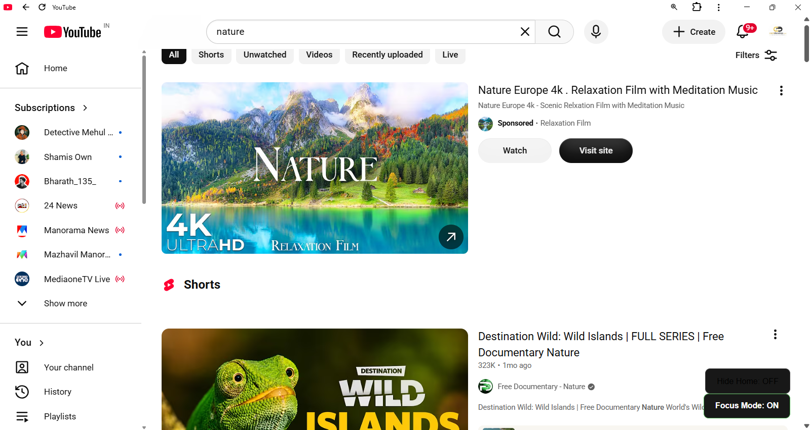
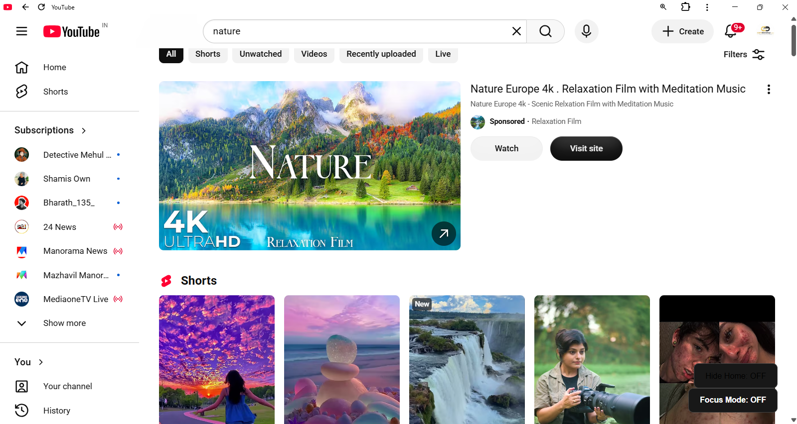
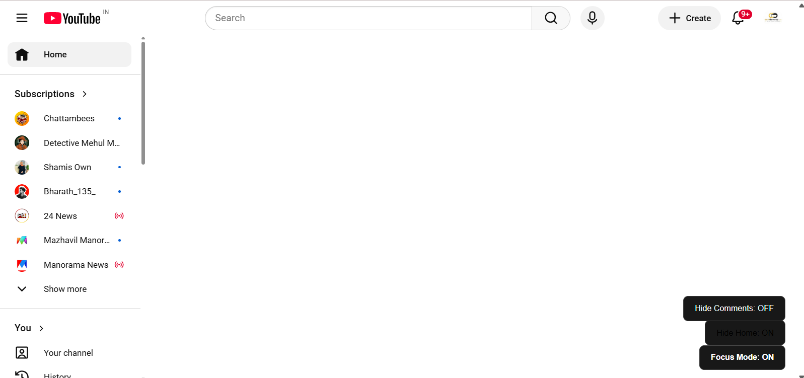
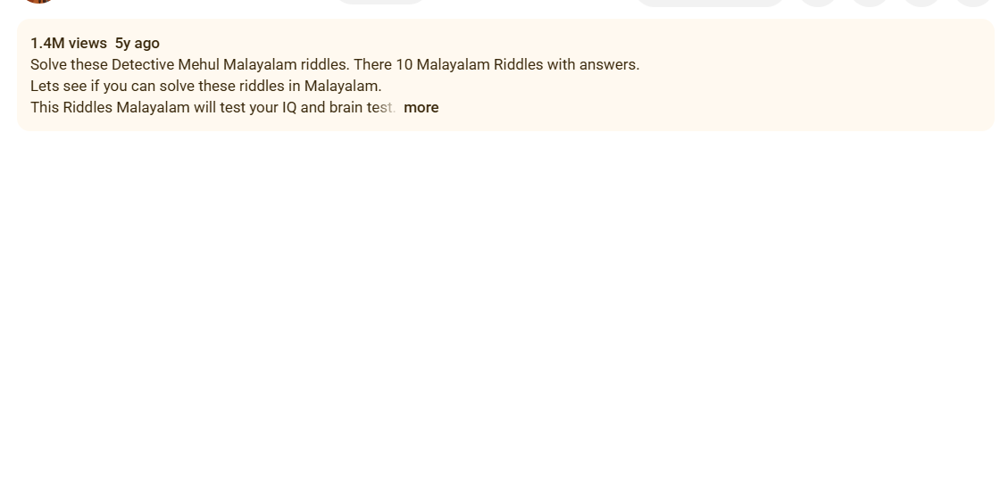

# DND For Youtube (Version 1.0.0)

**Everyone Heard about Do not disturb mode So i Made a DND For youtube**

# Features

 **What It does**

 *I hides Shorts and shorts related contents, Home recomedations from youtube while you clicking that appropriate button in the extension popup*

 *When you clicked on  hide home button it will turn off the home page recommendations*

 *When you clicked on hide shorts button it will turn off the shorts and shorts related contents*

 *When you click on the comments button it will disappear the comments sections from video page*

 # Screenshots

 **With Focus Mode**

 

 **Without Focus Mode**

 

 *You can see the difference between with focus mode and without focus mode*

**With Home Page Recommendations Mode**

  

 **Without Home Page Recommendations Mode(sorry this is a youtube used by mys sister and brother)**

 
 
 *You can see the difference between with home page recommendations mode and without home page recommendations mode*

 **With Comments Mode**

  

  **Without Comments Mode**

  *It is normal like what in youtube page*
# Installation

  - Download the extension by cloning the repo or downloading the zip file and extracting it.

  - Open Chrome and go to `chrome://extensions/`

  - Enable "Developer mode" 

  - Click on "Load unpacked" and select the folder where you extracted the extension.

  - Now the extension should be installed and ready to use.

  - open youtube.com and click on the extension icon to access and click on the appropriate button to enable the focus mode and also home page recommendations mode.

# Note

 **This extension is for educational purposes only and is not affiliated with  YouTube or Google.**

# License

 This project is licensed under the MIT License 

# Thank You

 **Thank you for using my extension. I hope it helps you stay focused and productive while using YouTube.**

# AI Usage

  **I used ai to debug the code because i was getting many errors in code while testing and also used ai to study to use this type of selectors in the code and helped me in script also because i am using this type of selectors first time**
 
 **Challenges:**

 - I was getting many errors in the code while testing and also like smth when changing from old selectors like first i used very old selectors and youtube is using more dynamic selectors so i was getting many errors in the code while testing so i studied more about new selectors and used this